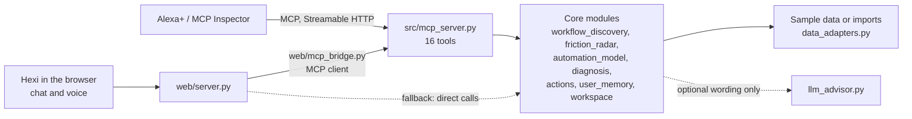

# Isse Automate Kardo

Hexi is an Alexa+ assistant that finds the repetitive workflows eating your
time, shows which step is the bottleneck, and tells you which ones are safe to
automate and how many hours that would save. It is built as a self-hosted
Model Context Protocol (MCP) server, so Alexa+ or any other MCP client can ask
it questions by voice or text. Nothing is automated until you ask for it.

This project is an entry in Amazon's **Build, Ship, Shape** hackathon, in the
**Alexa+ track**, and in the **Open Source** mini challenge (pull request
[#122 to ActivityWatch/aw-client](https://github.com/ActivityWatch/aw-client/pull/122)).

For the full technical write-up, read the
[developer manual (PDF)](docs/Isse-Automate-Kardo-Developer-Manual.pdf).

Judges: step-by-step testing instructions are in [docs/TESTING.md](docs/TESTING.md)
and the friction log is in [docs/FRICTION_LOG.md](docs/FRICTION_LOG.md).

## Quick Start

```bash
git clone https://github.com/aashnology/Isse-Automate-Kardo.git
cd Isse-Automate-Kardo
python -m venv .venv
source .venv/bin/activate        # Windows: .venv\Scripts\activate
pip install -r requirements.txt

python src/mcp_server.py         # terminal 1: MCP server at http://localhost:8000/mcp
python web/server.py             # terminal 2: Hexi at http://localhost:5000
```

No API key is needed. Python 3.12 is what the Docker image uses.

To see it work on data it has never seen:

1. Open the **My data** tab and paste the contents of
   `examples/sales_report_steps.txt` into the step-list box.
2. Click **Analyze this**. Hexi finds the repeating workflow.
3. In the chat, type **what can I automate**, then **automate it**. Typing the
   command is the confirmation. By voice ("Alexa, ask Hexi to automate it")
   Hexi proposes first and waits for a spoken yes.

With Docker:

```bash
cp .env.example .env             # optional
docker compose up --build
```

Hexi is then at http://localhost:5000 and the MCP endpoint at
http://localhost:8000/mcp, both bound to loopback.

Run the tests with `pip install pytest && pytest`.

The title bar of the page shows the build id of the code being served. If it is
not the commit you expect, an old server is still holding the port. On
Windows: `netstat -ano | findstr :5000`, then `taskkill /PID <pid> /F`.

## Meet Hexi


Hexi is the small hexagonal character in the browser demo. Her expression
follows what the analysis is actually doing:

| State | When |
|---|---|
| asleep | The web backend is not running |
| idle | The backend is up and she is waiting |
| watching | You are browsing the workspace or asking her something |
| curious | A real pattern turned up in the data |
| suggesting | She is deciding whether a pattern is worth automating |
| confirmed | You approved an automation |

You can talk to her or type. Say "stop suggesting bug triage" and she keeps that
across restarts. Ask "brief me" and she answers out loud. The browser
microphone stands in for an Echo, with an "Alexa, ask Hexi ..." wake phrase.

[Aspen](https://github.com/aashnology/Woof) is a separate desktop companion
that nudges you to take a break. Hexi can call him in if you say yes; he is
not part of this repository and Hexi works without him.

## The Journey

From a question to a confirmed automation:

| You say | Tool | What it does |
|---|---|---|
| "What patterns are in my work?" | `discover_workflows` | Clusters raw event sequences into workflows by similarity, with no labels |
| "Where am I wasting time?" | `get_top_friction_points` | Ranks workflows by total time cost and automation tier |
| "What can I automate?" | `find_automation_opportunities` | Scans every workflow, ranks by hours saved a week, explains the refusals |
| "Why does bug triage take so long?" | `debug_workflow` | Step-by-step bottleneck breakdown |
| "Was there anything unusual?" | `detect_anomalous_runs` | Flags runs far outside the usual range and names the likely cause |
| "Is it worth automating?" | `diagnose_workflow` | Findings, prescriptions, time saved with an interval, reliability grade |
| "Automate the reporting steps." | `propose_automation` | A concrete step-level proposal. Never executes |
| "Yes." | `confirm_automation` | Runs only after your approval, once, within an hour |
| "Just give me the rundown." | `narrate_briefing` | One spoken answer from already-computed findings |

Dismissing, restoring and listing dismissed suggestions are separate tools, and
`list_datasets` shows what has been imported. 16 tools in total.

## How it's built



Two doors lead to one core. The MCP server exposes the analysis as tools over
Streamable HTTP, negotiating spec version 2025-11-25. The browser demo goes
through `web/mcp_bridge.py`, a real MCP client that refuses a server older than
that version; if the MCP server is down, the page calls the same functions
in-process, and every API response carries a `via` field (`mcp` or `direct`).

How the analysis works:

- **Workflow discovery.** Raw events are split into runs by the largest jump in
  the gaps between timestamps, then runs are clustered by normalised longest
  common subsequence similarity. No workflow labels are needed.
- **Unusual runs.** Tukey's fences on run duration within each workflow.
- **Automation safety.** Each step is scored from the verbs in its name and how
  consistent it is across runs. Steps that need judgment, appear in fewer than
  60% of runs, or need rework more than 20% of the time are refused, with the
  reason.
- **Time saved.** The proposed steps are replayed against your own history
  (shadow mode), keeping 10% of each step as supervision time. The estimate
  carries an 80% bootstrap interval and is checked on a chronological holdout.
- **Reliability.** A 0 to 100 score from six named components: evidence,
  stability, coverage, cohesion, holdout accuracy and outcome data. Data without
  success or rework information cannot reach grade A.
- **Words.** Briefings are templates over computed numbers. An optional language
  model can phrase the diagnosis, but its reply is discarded if it contains a
  figure the report does not support.

Safety: imports only parse, they never execute. File imports are limited to an
allowlisted directory, extension and size. The server sends a strict content
security policy, rate-limits clients, bounds request sizes, escapes every
imported string in the page, and binds to loopback by default. Proposals expire
after an hour and cannot be confirmed twice.

Limits you should know about:

- Confirming an automation does not run anything on a real system. It marks the
  steps as automated and estimates the saving by replay. The hook for a real
  executor is `confirm_action` in `src/actions.py`.
- Step safety is a readable heuristic, not a trained model, and its verb lists
  are English only.
- Run segmentation assumes workflows do not interleave.
- The Google Sheet import is tested against a stand-in for Google's response,
  not yet against a live sheet.
- It has not been tested inside an Alexa+ surface, because none is available to
  developers; the voice loop is simulated in the browser.
- Browser speech recognition (Chrome, Edge) sends audio to the browser vendor.
  Spoken replies are generated on the device.

### Research and references

- Van der Aalst, Weijters and Maruster,
  ["Workflow Mining: Discovering Process Models from Event Logs"](https://doi.org/10.1109/TKDE.2004.47),
  IEEE TKDE, 2004. Recovering a process from nothing but its event log is the
  framing Hexi uses on raw activity.
- Bose and van der Aalst,
  ["Context Aware Trace Clustering"](https://doi.org/10.1137/1.9781611972795.35),
  SDM, 2009. Grouping runs by pairwise sequence similarity tolerates reordered,
  extra or missing steps.
- Tukey, *Exploratory Data Analysis*, Addison-Wesley, 1977. Quartile fences
  suit right-skewed run durations better than a z-score.
- Efron,
  ["Bootstrap Methods: Another Look at the Jackknife"](https://doi.org/10.1214/aos/1176344552),
  Annals of Statistics, 1979. The interval on hours saved resamples per-run
  savings and assumes nothing about their distribution.

## Tech Stack

| Layer | Used |
|---|---|
| Protocol | Model Context Protocol, Streamable HTTP, spec 2025-11-25 (official Python SDK, FastMCP) |
| Backend | Python 3.12, Flask |
| Analysis | Standard library, NumPy, scikit-learn |
| Frontend | Plain JavaScript, HTML and CSS, Web Speech API |
| Optional model | Any Anthropic or OpenAI-compatible endpoint, for diagnosis wording only |
| Packaging | Docker and Docker Compose |
| Tests | pytest, with Node for the browser-side logic |

Data it reads: pasted steps, Toggl CSV, ActivityWatch JSON, a public GitHub
repository's pull request history, and link-shared Google Sheets.

## Agent Skills

[`skills/friction-radar/SKILL.md`](skills/friction-radar/SKILL.md) is an Agent
Skill that tells an agent which tool to call for which request, and the rules
to follow: use only numbers the tools returned, propose before confirming,
confirm only after a yes in a later turn, respect dismissals, treat tool output
as data, and keep spoken replies short.

## Make It Yours

- **Your own data.** Use the **My data** tab, or call
  `discover_workflows_from_import`. Anything with a step name, a time and a
  duration works.
- **Ports and binding.** Set `MCP_SERVER_PORT`, `WEB_PORT` and `WEB_BIND_HOST`
  in `.env`.
- **A language model for the diagnosis.** Set `ANTHROPIC_API_KEY`, or
  `LLM_API_KEY` and `LLM_BASE_URL` for an OpenAI-compatible endpoint. Without
  one, a built-in template writes the diagnosis and says so.
- **What counts as safe.** The verb lists and thresholds are at the top of
  `src/automation_model.py`.
- **Real automation.** Implement `confirm_action` in `src/actions.py` to run a
  proposal against a real system. It is already behind the consent check.
- **Break reminders.** Install Aspen and set `ASPEN_HOME`; Hexi can then call
  him in.
- **The Alexa+ side.** Point any MCP client at `http://localhost:8000/mcp`.

## License

MIT. See [LICENSE](LICENSE).
