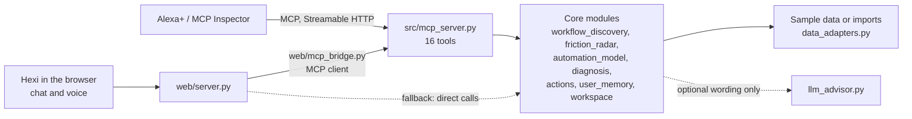

# Isse Automate Kardo


Hexi is an assistant that finds where your time goes, points at the one step
slowing a workflow down, and tells you what is worth automating. It speaks
the Model Context Protocol, so Alexa+ or any other MCP client can ask it
questions by voice or text. Nothing is automated until you ask for it, and by voice
it asks for a second "yes" before it acts.

Built for Amazon's **Build, Ship, Shape** hackathon: **Alexa+ track**, with an
entry in the **Open Source** mini challenge.

- Developer manual (PDF): [`docs/Isse-Automate-Kardo-Developer-Manual.pdf`](docs/Isse-Automate-Kardo-Developer-Manual.pdf)
- Design notes, references and known limits: [`docs/RESEARCH_AND_NOTES.md`](docs/RESEARCH_AND_NOTES.md)

## What it does

You give Hexi a record of repetitive work: pasted steps with durations, a Toggl
CSV, an ActivityWatch JSON export, a public GitHub repo's pull request
history, or a link-shared Google Sheet. Hexi then:

1. Discovers the recurring workflows from the data itself, with no labels.
2. Shows which step takes the largest share of each workflow, and flags runs
   that were unusually slow.
3. Scores every step for how safe it is to automate. Steps that need judgment
   (review, approve, write) are refused, with the reason.
4. Ranks all workflows by the hours a week automation would have saved.
5. Proposes automating the safe steps. Once you confirm, Hexi reports the time
   saved (with a confidence interval) and a reliability score, both computed
   by replaying your own history.

Ask it things like "what can I automate", "what's costing me time", "why is
reporting slow", "is it worth automating", "automate it", or "stop suggesting
bug triage". It remembers what you dismiss, so it does not nag twice.

## How it uses MCP

The analysis is exposed as MCP tools by `src/mcp_server.py`, a FastMCP server
on Streamable HTTP. The browser demo does not call the Python directly: its
voice and chat paths go through `web/mcp_bridge.py`, a real MCP client that
refuses to continue if the server negotiates a protocol older than
2025-11-25. If the MCP server is not running, the page falls back to calling
the same functions in-process, and every API response carries a `via` field
(`mcp` or `direct`) saying which path answered.



Scoring and ranking are deterministic code. The optional language model in
`llm_advisor.py` only phrases the diagnosis, and its reply is discarded if it
contains a number the computed report does not support.

### Tools

| Tool | Use |
|---|---|
| `narrate_briefing` | One spoken update across everything |
| `get_top_friction_points` | Where time is going |
| `find_automation_opportunities` | What is worth automating, ranked by hours saved |
| `debug_workflow` | Step-by-step breakdown of one workflow |
| `detect_anomalous_runs` | Runs that took unusually long |
| `diagnose_workflow` | Findings, prescriptions, time saved, reliability |
| `propose_automation` | Propose only; never executes |
| `confirm_automation` | Runs after an explicit yes; one-time, expires after an hour |
| `discover_workflows`, `discover_workflows_from_import` | Label-free workflow discovery |
| `explain_friction`, `estimate_time_cost`, `list_datasets` | Supporting detail |
| `dismiss_workflow_suggestions`, `restore_workflow_suggestions`, `list_dismissed_workflow_suggestions` | Standing preferences that survive restarts |

Read-only tools are annotated read-only and idempotent; `confirm_automation`
is the one annotated destructive.

### Agent Skill

[`skills/friction-radar/SKILL.md`](skills/friction-radar/SKILL.md) tells an
agent which tool to call for which request and the rules to follow (propose
before confirm, respect dismissals).

## Quick start

```bash
git clone https://github.com/aashnology/Isse-Automate-Kardo.git
cd Isse-Automate-Kardo
python -m venv .venv
source .venv/bin/activate        # Windows: .venv\Scripts\activate
pip install -r requirements.txt

python src/mcp_server.py         # terminal 1: MCP server at http://localhost:8000/mcp
python web/server.py             # terminal 2: Hexi at http://localhost:5000
```

Python 3.12 is what the Docker image uses. No API key is needed. Copy
`.env.example` to `.env` only if you want to change ports or add a model.

To see it work on data it has never seen:

1. Open the **My data** tab and paste the contents of
   `examples/sales_report_steps.txt` into the step-list box.
2. Click **Analyze this**. Hexi finds the repeating workflow.
3. In the chat, type **what can I automate**, then **automate it**. Typing the
   command is the confirmation. By voice ("Alexa, ask Hexi to automate it")
   Hexi proposes first and waits for a spoken yes.

The title bar shows the build id of the code being served. If it is not the
commit you expect, an old server is still holding the port (on Windows:
`netstat -ano | findstr :5000`, then `taskkill /PID <pid> /F`).

### Docker

```bash
cp .env.example .env             # optional
docker compose up --build
```

Hexi is at http://localhost:5000 and the MCP endpoint at
http://localhost:8000/mcp, both bound to loopback. Imported datasets live in a
named volume shared by both services.

### Tests

```bash
pip install pytest && pytest
```

The suite covers the MCP protocol end to end with a real client, the import
adapters, the safety checks on imported data, concurrency on proposals and
memory, and the browser-side intent router.

## Limits

- Confirming an automation does not run anything on a real system. It marks
  the steps as automated and produces a replay of your history to estimate the
  saving. The hook for a real executor is `confirm_action` in `src/actions.py`.
- Step safety is a heuristic: verbs in the step name, plus how consistent the
  step is across runs. It is readable and testable, not a trained model.
- The Google Sheet import is tested against a stand-in for Google's response,
  not yet against a live sheet.
- The browser's speech recognition (Chrome, Edge) sends audio to the browser
  vendor's service. Spoken replies are generated on the device.

## Aspen

[Aspen](https://github.com/aashnology/Woof) is a separate desktop companion
that nudges you to take a break. Hexi can call him in if you say yes; he is
not part of this repository and Hexi works without him.

## Research & References

The methods behind the parts that are not obvious, and why each was used:

- **Process mining, for finding workflows without labels.** Van der Aalst,
  Weijters and Maruster, ["Workflow Mining: Discovering Process Models from
  Event Logs"](https://doi.org/10.1109/TKDE.2004.47), IEEE TKDE, 2004. Their
  framing is to recover a process from nothing but its event log, which is
  what Hexi does with raw activity.
- **Trace clustering, for grouping runs of the same workflow.** Bose and van
  der Aalst, ["Context Aware Trace
  Clustering"](https://doi.org/10.1137/1.9781611972795.35), SDM, 2009. Runs
  are grouped by pairwise sequence similarity (normalised longest common
  subsequence), which tolerates reordered, extra or missing steps between two
  runs of the "same" workflow.
- **Tukey's IQR fences, for unusual runs.** Tukey, *Exploratory Data
  Analysis*, Addison-Wesley, 1977. Run durations are right-skewed, so a
  fence based on quartiles suits them better than a z-score.
- **The bootstrap, for the saving estimates.** Efron, ["Bootstrap Methods:
  Another Look at the Jackknife"](https://doi.org/10.1214/aos/1176344552),
  Annals of Statistics, 1979. The 80% interval on hours saved resamples the
  per-run savings, so it makes no assumption about their distribution.

## Open source contribution

Pull request [#122 to ActivityWatch/aw-client](https://github.com/ActivityWatch/aw-client/pull/122),
an example script, revised after maintainer review. Hexi reads ActivityWatch
exports, which is how it came up.

## License

[MIT](LICENSE).
